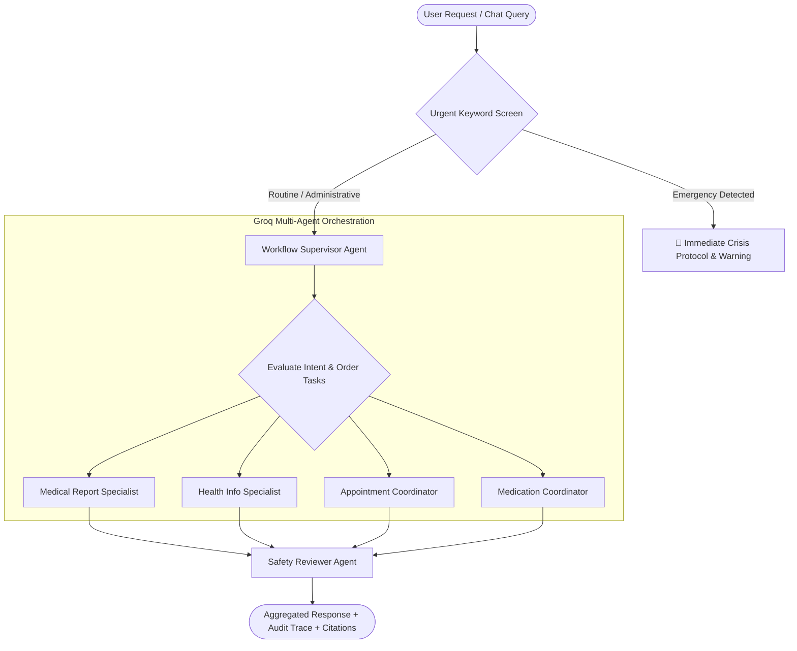

# MediAssist – Multi-Agent Healthcare Management Platform

[](https://python.org)
[](https://fastapi.tiangolo.com)
[](https://react.dev)
[](https://www.typescriptlang.org)
[](https://tailwindcss.com)
[](https://groq.com)
[](LICENSE)

> **MediAssist** is a multi-agent healthcare coordination platform powered by FastAPI, React, and Groq AI. It features six specialized agent roles for triage routing, lab report analysis, appointment booking, and medication adherence. Built with strict privacy-by-design, safety guardrails, and zero autonomous clinical prescribing or hallucination.

---

## 🌟 Key Features

- **Six Cooperating Agent Roles**: Autonomous task routing, supervisor orchestration, and deterministic fallback powered by ultra-low-latency Groq LLM inference.
- **Privacy-by-Design**: Patient identity, medical history, raw chat queries, and uploaded documents are **never sent to external LLMs**. Only sanitized, constrained workflow metadata is processed.
- **Local PDF Report Analysis**: Upload lab test reports (PDF, up to 5 MB); parses selectable text securely in-memory using `PyMuPDF` with verbatim reference comparisons.
- **Atomic Appointment Booking**: Real-time scheduling with verified clinicians preventing double-booking and concurrency conflicts.
- **Medication Reminders & Adherence**: Daily schedules with timezone-aware due calculations and adherence logging.
- **Deterministic Emergency Guardrails**: Real-time screening intercepts high-urgency keywords (e.g., chest pain, shortness of breath, severe bleeding) to provide immediate emergency instructions.
- **Role-Based Workspaces**: Distinct dashboards tailored for **Patients**, **Doctors**, and **Administrators**.

---

## 🧠 Multi-Agent Architecture



### The Six Cooperating Roles

| Agent Role | Model / Engine | Core Responsibility |
|---|---|---|
| **Workflow Supervisor** | Groq LLM (`qwen/qwen3.8-27b`) | Evaluates workflow metadata and orders required specialist tasks. |
| **Medical Report Specialist** | Local In-Memory Parser | Extracts verified report text locally; produces verbatim excerpts. |
| **Health Info Specialist** | Curated Knowledge Base | Matches clinical terms against peer-reviewed references with citations. |
| **Appointment Coordinator** | Live SQL Engine | Checks availability, verified doctor status, and future open slots. |
| **Medication Coordinator** | Local Timezone Engine | Computes scheduled dosages, active regimens, and adherence logs. |
| **Safety Reviewer** | Deterministic Policy Guard | Ensures zero autonomous write actions; confirms disclaimers. |

---

## 🖥️ Workspaces & Demo Credentials

| Role | Email | Password | Access & Capabilities |
|---|---|---|---|
| **Patient** | `patient@demo.test` | `DemoPass123!` | Upload PDFs, chat with triage agents, book slots, log medication adherence |
| **Doctor** | `doctor1@demo.test` | `DemoPass123!` | Open consultation slots, review assigned visits, write consultation notes |
| **Administrator** | `admin@demo.test` | `DemoPass123!` | View aggregate platform metrics, register and verify doctor credentials |

*Additional synthetic doctors: `doctor2@demo.test` (Cardiology) and `doctor3@demo.test` (Dermatology).*

---

## 🛠️ Technology Stack

- **Frontend**: React 19, TypeScript 5.7, Tailwind CSS 3.4, Lucide Icons, Vite 6
- **Backend**: FastAPI, Python 3.12, Uvicorn, Pydantic v2, PyMuPDF
- **Database & ORM**: SQLAlchemy 2.0 (SQLite for rapid local demo; PostgreSQL 16 ready for Docker)
- **AI & Reasoning**: Groq Cloud API (`qwen/qwen3.8-27b`, `openai/gpt-oss-20b`) + CrewAI compatibility layer
- **Security**: PBKDF2-SHA256 password hashing, PyJWT (HS256 tokens), rate-limiting middleware, secure HTTP response headers

---

## 🚀 Quick Start

### 1. Clone & Configure

```bash
git clone https://github.com/ROHITH-NATHANI/MediAssist.git
cd MediAssist
cp .env.example .env
```

Open `.env` and set your Groq API key:
```ini
GROQ_API_KEY=your_groq_api_key_here
GROQ_MODEL=groq/qwen/qwen3.8-27b
AGENT_MODE=crewai
```

---

### 2. Run with Docker (Recommended)

Ensure Docker Desktop is running, then:

```bash
docker compose up --build
```

- Frontend App: [http://localhost:8080](http://localhost:8080)
- Backend Docs: [http://localhost:8000/docs](http://localhost:8000/docs)

---

### 3. Run Locally without Docker

#### Backend:
```bash
cd backend
python -m venv .venv
# Windows PowerShell:
.\.venv\Scripts\Activate.ps1
# Linux/macOS:
source .venv/bin/activate

pip install -r requirements.txt
python -m uvicorn app.main:app --reload --port 8000
```

#### Frontend:
```bash
cd frontend
npm install
npm run dev
```

- Frontend Dev: [http://localhost:5173](http://localhost:5173)
- Backend API: [http://localhost:8000](http://localhost:8000)

---

## 🧪 Testing & Verification

### Unit & Integration Tests
Run pytest in the `backend` folder:
```bash
cd backend
python -m pytest -v
```
*Result: 10/10 passed (Authentication, Atomic Booking, Isolation, Medications, Emergency Interception, Admin).*

### Evaluation Suite
Run the synthetic evaluation benchmark against the live backend:
```bash
python evaluation/evaluate.py
```
*Result: 9/9 passed (100% routing match, zero clinical hallucination, urgent keyword interception).*

---

## 🔒 Security & Medical Disclaimer

> **Educational & Coordination Prototype Only**  
> MediAssist is an educational prototype and is **not** a certified medical device, emergency service, or clinical diagnostic tool. It does not provide medical advice, diagnosis, or treatment recommendations. Never upload confidential or personally identifiable patient health information (PHI). In any medical emergency, contact local emergency services immediately.

---

## 📄 License

This project is licensed under the [MIT License](LICENSE).
